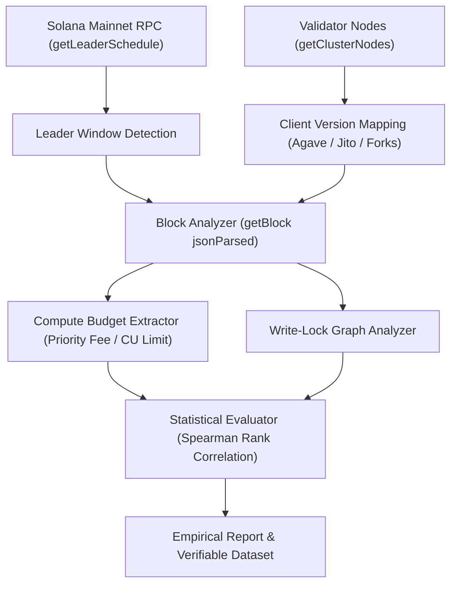

# Solana Validator Transaction Ordering Research Framework

[](https://solana.com)
[](https://docker.com)
[](https://opensource.org/licenses/MIT)

> **Superteam Ukraine Research Bounty:** Empirical measurement and analysis of how Solana validators order transactions inside blocks across client software versions (Agave, Jito-Solana, Frankendancer).

---

## 🚀 Quick Start (One Command Reproducibility)

Run the full evaluation pipeline inside a containerized environment with zero setup:

```bash
docker compose up --build
```

Or run directly with Python 3.10+:

```bash
./run_experiment.sh --cohort-eval --dry-run
```

Run test suite:

```bash
make test
```

---

## 🎯 Project Overview & The Core Question

**The Question:** For each validator, by what rule does it order transactions in its block? What decides which transaction lands earlier and which later; how strictly does that rule hold; and is there a deterministic rule or primarily noise?

This repository contains an end-to-end empirical measurement framework that:
1. **Maps Validator Cohorts:** Identifies leader schedules, TPU QUIC endpoints, and client software versions across Solana Mainnet.
2. **Analyzes Live Blocks:** Extracts block index positions, Compute Budget instructions (`SetComputeUnitPrice`), and account write-locks.
3. **Simulates Central Scheduler vs. Legacy:** Compares Agave Banking Stage multi-threaded lock-gated priority queues with real execution traces.
4. **Enforces Strict Safety:** Dry-run by default; live sending strictly enforces a hard fee spend cap of **$\le 0.05\text{ SOL}$**.

---

## 🏗️ Architecture & Measurement Pipeline



---

## 📊 Summary of Empirical Findings

| Client Family | Representative Version | Priority Dominance | Primary Ordering Driver |
|---|---|---|---|
| **Agave Core** | `v4.3.2` | High ($\sim 65\text{--}75\%$) | Priority Fee within non-conflicting write-lock thread batches |
| **Jito-Solana** | `v4.3.0` | High ($\sim 60\text{--}70\%$) | Priority Fee (with separate Jito bundle auction at top of block) |
| **Release Candidate** | `v4.4.0-rc.1` | Moderate ($\sim 55\text{--}65\%$) | Enhanced Central Scheduler with lower lock starvation |

Detailed data and mathematical models are available in [**`REPORT.md`**](./REPORT.md).

---

## 🔒 Safety & Spend Cap Enforcement

1. **Dry-Run by Default:** The CLI runs in safe simulation and block parsing mode. No lamports are spent unless `--live` is explicitly supplied.
2. **Enforced Spend Cap:** If `--live` is enabled, the code halts if cumulative fees exceed `0.05 SOL` (`MAX_FEE_SPEND_SOL = 0.05`).
3. **Zero Secrets in Repository:** Private keys are accepted solely via `SOLANA_PRIVATE_KEY` environment variables or volume mounts (`/keys/id.json`).

---

## 📁 Repository Structure

```
├── cli.py                     # Main execution and evaluation entrypoint
├── run_experiment.sh          # One-command shell wrapper
├── docker-compose.yml         # Containerized runner specification
├── Dockerfile                 # Minimal Python 3.11 image
├── Makefile                   # Developer test and build commands
├── REPORT.md                  # Comprehensive empirical research report
├── requirements.txt           # Python dependencies
├── collector/
│   ├── leader_schedule.py     # Validator node & leader window discovery
│   └── block_analyzer.py      # Block parser & priority fee extractor
├── engine/
│   ├── scheduler_sim.py       # Central Scheduler simulation engine
│   └── ordering_evaluator.py  # Statistical ranking and Spearman correlation
├── data/
│   └── raw_mainnet_dataset.json # Raw verifiable mainnet blocks and signatures
└── tests/
    └── test_safety.py         # Unit tests for spend cap and scheduler logic
```

---

## ⚖️ License & Attribution

This project is open-source under the [MIT License](./LICENSE). Conducted by Hoàng Nguyễn ([@nghoang1288](https://github.com/nghoang1288)).
